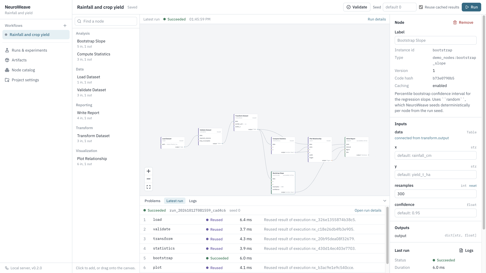

# NeuroWeave

NeuroWeave is a local-first, graph-native environment for reproducible computational
research. You write analysis steps as ordinary Python functions, connect them into a typed
workflow graph (in code or in the visual Studio), and every run is recorded: the exact graph
that executed, each node's code hash, parameters, seed, inputs, outputs, logs, metrics and the
software environment. Runs can be compared, re-executed and checked for byte-identical
reproduction, and any result can be traced back to the files it came from.



**Status: early but working (v0.2.0).** The graph kernel, local runtime, artifact store,
provenance, caching, run comparison, reproduction checks, CLI, HTTP API and Studio are
implemented and tested on macOS with Python 3.11+ (developed on 3.14). There is **no
sandbox**: nodes run as your user with full access to your files and network. Read
[Limitations](#limitations) and [docs/security.md](docs/security.md) before running
workflows you did not write.

## Quick start

Requirements: Python 3.11 or newer. Node.js 20+ is needed only to build the Studio from
source.

```bash
git clone https://github.com/j4b3-21/neuroweave.git
cd neuroweave
python -m venv .venv && source .venv/bin/activate
pip install -e ".[dev]"

# Build the Studio UI once (the API and CLI work without it)
npm --prefix apps/studio install
npm --prefix apps/studio run build
```

Run the bundled research demo (load a CSV, validate, transform, compute statistics,
bootstrap a confidence interval, plot, write a report):

```bash
cp -R examples/research_demo /tmp/nw-demo && cd /tmp/nw-demo
nw init --name "Rainfall and yield" -m demo_nodes
nw workflows import workflow.json
nw run rainfall-yield          # executes all 7 nodes
nw run rainfall-yield          # every node is reused from the cache
nw runs                        # list recorded runs
nw studio                      # open the visual Studio at http://127.0.0.1:8765
```

`nw init` created this project, so it is trusted. A project that already contains
`.neuroweave/` (a cloned repository, an archive, a shared folder) is not: NeuroWeave asks
before importing its node code, and `nw trust` grants it. See
[docs/security.md](docs/security.md#opening-a-project-trust).

See [examples/research_demo/README.md](examples/research_demo/README.md) for a guided tour
covering comparison, reproduction and lineage.

## Writing nodes

A node is a typed Python function. Parameters become input ports; the return annotation
becomes the output port. Inputs with JSON-compatible types (numbers, strings, booleans,
literals, lists, dicts) can also be set as parameters in the Studio, which generates a
matching form field.

```python
from pathlib import Path
from typing import Literal

from neuroweave import Table, log_metric, node


@node(category="Data")
def load_dataset(path: Path) -> Table:
    """Load a CSV file into a Table."""
    return Table.from_csv(path)


@node(category="Transform", version="2")
def transform(data: Table, unit: Literal["cm", "mm"] = "cm", outlier_z: float = 3.0) -> Table:
    ...
    log_metric("outliers_removed", removed)
    return cleaned
```

- `Path` inputs are treated as files: their content hash is recorded, and small files are
  copied into the artifact store so lineage reaches the original data.
- `Table`, `Figure` (SVG) and `Markdown` are built-in result types with previews in the
  Studio. Other JSON values, strings and bytes are stored as-is; other Python objects fall
  back to pickle.
- `random` (and NumPy's global generator, if NumPy is imported) is seeded per node from the
  run seed, so stochastic nodes are repeatable.
- Bump `version=` when a node's behaviour changes through code the hash cannot see
  (helpers in other modules, data files). See [docs/reproducibility.md](docs/reproducibility.md).

List the module in the project (`nw init -m my_nodes`, or Project settings in the Studio).
Workflows can also be built in code with `neuroweave.WorkflowBuilder`; see
`examples/research_demo/build_workflow.py`.

## Command line

All commands accept `--project/-C PATH`; otherwise the project is found by searching upward
from the current directory.

| Command | Purpose |
|---|---|
| `nw init [--name N] [-m MODULE]` | Create `.neuroweave/` in the current directory (and trust the new project) |
| `nw trust [--revoke]` | Allow (or stop allowing) this project's node modules to be imported |
| `nw nodes [--json]` | List node definitions and module import errors |
| `nw workflows list / import FILE [--force] / export ID` | Manage workflow files |
| `nw validate ID` | Check a workflow against the node catalog |
| `nw run ID [--seed N] [--no-cache]` | Execute and record a run |
| `nw runs`, `nw show RUN`, `nw logs RUN NODE` | Inspect run history |
| `nw artifacts`, `nw artifact ID [-o FILE]` | List or export results |
| `nw verify [ID] [--all]` | Re-hash stored bytes and detect tampering or corruption |
| `nw lineage ID [--downstream] [--json]` | Trace what produced (or used) an artifact |
| `nw compare RUN_A RUN_B [--json]` | Diff snapshots, parameters, inputs, code, outputs, metrics, environment |
| `nw reproduce RUN` | Re-execute with the same snapshot and seed, no cache, and compare output hashes |
| `nw studio [--port 8765] [--no-open]` | Serve the Studio and API on localhost |

## Studio

The Studio is a React application served by `nw studio`. It edits the same workflow files
the CLI uses and shows the same run records.

- **Workflow editor**: node palette (click or drag), typed ports coloured by type,
  connections checked by the kernel's type rules, parameter forms generated from type
  annotations, validation problems, autosave, run with seed and cache controls, live node
  status and logs.
- **Runs and experiments**: run history, run details (nodes, metrics, outputs, environment),
  side-by-side comparison of two runs, one-click reproduction with a verdict, and restoring
  the exact workflow version a run executed.
- **Artifacts**: previews for tables, figures, Markdown reports, JSON and text; integrity
  verification; download; an interactive lineage graph upstream or downstream.
- **Node catalog** and **Project settings** (node modules, default seed).

For frontend development, run `nw studio --no-open` in a project and, in another terminal,
`npm --prefix apps/studio run dev` (Vite proxies `/api` to port 8765, or `NEUROWEAVE_PORT`).

## Development

```bash
pip install -e ".[dev]"
ruff check src tests examples
pytest                                  # Python tests (uses temporary directories only)
npm --prefix apps/studio run typecheck
npm --prefix apps/studio test           # Vitest unit tests
npm --prefix apps/studio run build      # writes src/neuroweave/server/static
npm --prefix apps/studio exec -- playwright install chromium   # once
npm --prefix apps/studio run test:e2e   # build, then browser tests against real `nw studio` servers
```

The browser tests (`apps/studio/e2e/`) create a fresh temporary project and start their own
`nw studio` on a free port for every test, so they never touch your projects. They use the
repository's `.venv` interpreter, or `NEUROWEAVE_PYTHON` if set, and block any request that
leaves the machine. On failure, traces and screenshots are written to
`apps/studio/test-results/` (open one with
`npm --prefix apps/studio exec -- playwright show-trace PATH`).

CI runs the Python steps on Python 3.11 and 3.14, the Studio checks, and the browser tests
(`.github/workflows/ci.yml`).

Repository layout:

```text
src/neuroweave/
  kernel/       workflow model, type system, validation, planning, diff, canonical JSON
  sdk/          @node decorator, registry, introspection, WorkflowBuilder, run context
  runtime/      executor, worker process, cache keys, environment capture, catalog discovery
  store/        workspace files, SQLite database, content-addressed artifact store
  server/       FastAPI app and run/catalog services; built Studio in static/
  provenance.py lineage queries
  experiments.py run comparison and reproduction
  cli.py        the nw command
apps/studio/    React + TypeScript Studio
examples/research_demo/
tests/
docs/
```

## Limitations

- **No sandbox.** Node code runs in a child process with your user's permissions, file
  access and network. The Studio and API bind to `127.0.0.1` and reject other hosts and
  cross-site browser requests, but any local process can call the API. NeuroWeave asks before
  importing code from a project you did not create, but that is a confirmation step, not
  isolation: only trust node modules (and received `.neuroweave/` stores, which may contain
  pickles) that you would run as an ordinary Python script.
- **Reproducibility is evidence, not a guarantee.** NeuroWeave records the environment but
  does not recreate it, and the code hash covers only the node function's own source. See
  [docs/reproducibility.md](docs/reproducibility.md) for what is and is not detected.
- **Sequential execution** of nodes in one worker process per run; no parallelism or
  distributed execution yet.
- **Python only.** Nodes in other languages are not supported.
- **Single user, single machine.** No accounts, sharing or cloud storage. Concurrent edits
  to the same workflow are detected and refused rather than merged.
- Large data is hashed but only copied into the store below a size limit
  (`max_input_snapshot_bytes`, 50 MB by default); larger inputs must stay where they are for
  later reproduction.
- Deferred features (AI-assisted authoring, Docker isolation, research branching,
  collaboration) are listed with prerequisites in
  [docs/implementation-plan.md](docs/implementation-plan.md).

## Documentation

- [docs/architecture.md](docs/architecture.md): how the system is built
- [docs/decisions.md](docs/decisions.md): architectural decisions and their rationale
- [docs/reproducibility.md](docs/reproducibility.md): caching, seeds, reproduction policy, blind spots
- [docs/security.md](docs/security.md): threat model and protections
- [docs/implementation-progress.md](docs/implementation-progress.md): status and next steps
- [docs/release-readiness.md](docs/release-readiness.md): what has been verified for a release, with evidence
- [docs/architecture-audit.md](docs/architecture-audit.md): audit of the starting point
- `Architecture.md` and `ResearchOS.md`: the original proposal and long-term vision
