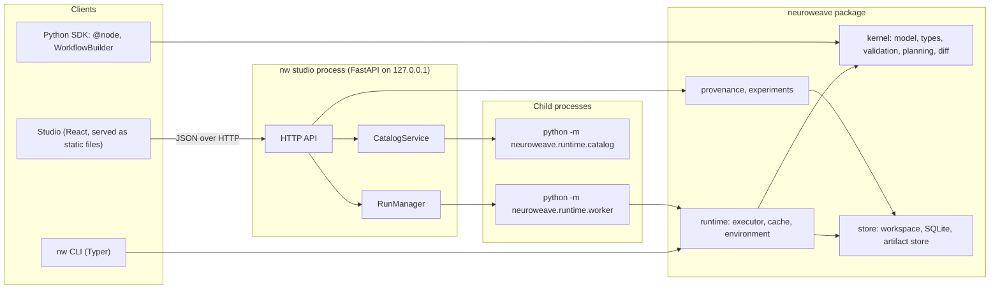
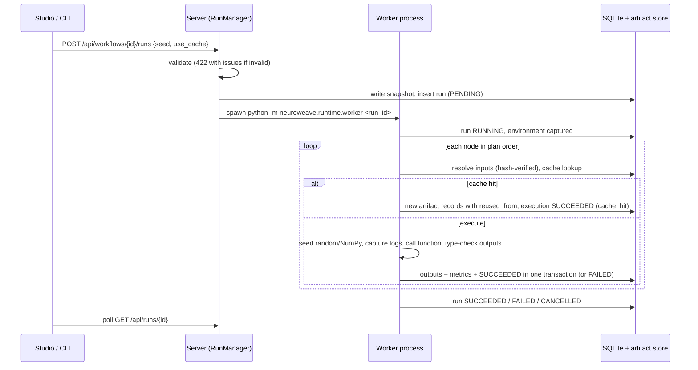

# NeuroWeave architecture (as implemented, v0.2.0)

This document describes the system that exists in this repository. `Architecture.md` at the
repository root is the original proposal; the table at the end maps its components to the
code. Decisions and their rationale are recorded in [decisions.md](decisions.md).

## 1. Principles

1. **The workflow graph is the source of truth.** Editors (Studio, `WorkflowBuilder`, JSON
   files) only produce `Workflow` documents; execution, caching, comparison and provenance
   are all derived from the immutable snapshot of the graph that ran.
2. **Record facts, label inferences.** Provenance edges observed during execution are
   stored; relations inferred afterwards (for example, two artifacts with identical bytes)
   are labelled `inferred`.
3. **Local-first and file-based.** A project is a directory; all state lives in its
   `.neuroweave/` folder and can be inspected with ordinary tools.
4. **Honest limits.** Anything that is not verified (environment equality, isolation) is
   reported as a note or limitation, never as a guarantee.

## 2. Components



| Package | Responsibility |
|---|---|
| `neuroweave.kernel` | Pure data model and logic with no I/O: `Workflow`, `NodeInstance`, `Edge`, `TypeSpec`, `NodeDefinition`, validation, deterministic planning, canonical JSON and snapshot hashing, semantic diff |
| `neuroweave.sdk` | Turns Python functions into `NodeDefinition`s (`@node`), registries, module loading, `WorkflowBuilder`, the in-run `NodeContext` and `log_metric` |
| `neuroweave.runtime` | Executes a run: input resolution, seeding, log capture, cache lookups, output serialization, state transitions; environment capture; the worker and catalog child-process entry points |
| `neuroweave.store` | The workspace directory, the SQLite database and the content-addressed artifact store; atomic file writes |
| `neuroweave.provenance` | Upstream and downstream lineage queries over recorded executions and artifacts |
| `neuroweave.experiments` | Run comparison and reproduction reports |
| `neuroweave.server` | FastAPI application, run manager, catalog service, static Studio |
| `neuroweave.cli` | The `nw` command |
| `apps/studio` | The Studio frontend (React 19, TypeScript, Vite, Tailwind, React Flow, TanStack Query, Zustand) |

## 3. Data model

### Node definitions

`@node` inspects a function and produces a `NodeDefinition`:

- `id` is `module:qualname` (stable across processes); `name`, `label`, `category`,
  `description`, `tags` are presentation metadata.
- `version` is declared by the author (default `"1"`); `code_hash` is the SHA-256 of the
  function's source text.
- Every parameter becomes an input `PortSpec` with a `TypeSpec` parsed from its annotation,
  `required`/`default`, and, for JSON-compatible types, `editable=True` plus a UI `widget`
  (`integer`, `number`, `text`, `checkbox`, `select`, `file`, `json`).
- Outputs come from the return annotation: one `output` port, or several named ports via
  `outputs=[...]` (the function returns a dict).
- `cache=False` opts a node out of result reuse.

`TypeSpec` kinds are `any`, `none`, `primitive`, `list`, `dict`, `optional`, `union`,
`literal`, `file` and `domain` (named classes such as `Table`). `compatibility(source,
target)` returns `ok`, `warning` (for example `Any` into `int`, or `Optional[T]` into `T`) or
`error`; only errors make a workflow invalid.

### Workflows

```text
Workflow { schema_version: 1, id, name, description,
           nodes: [NodeInstance { id, type, label, params, position }],
           edges: [Edge { source, source_port, target, target_port }] }
```

`validate_workflow(workflow, definitions)` returns a `ValidationReport` with structured
issues (`code`, `severity`, `message`, `node_id`, `port`, `edge`) and the execution order.
Checks: empty workflow, duplicate nodes/edges, unknown nodes, ports and node types,
self-loops, cycles, type mismatches, several connections into one input, unknown or
non-editable parameters, a parameter that is also connected, invalid parameter values, and
missing required inputs.

Planning is Kahn's algorithm with ties broken by declaration order, so the same graph always
executes in the same order. `snapshot_hash` is the SHA-256 of the canonical JSON (sorted
keys, no whitespace, UTF-8).

## 4. Storage layout

```text
project/
  .neuroweave/
    project.json            name, node_modules, default_seed, max_input_snapshot_bytes
    workflows/<id>.json     editable workflow definitions (pretty JSON, atomic writes)
    snapshots/<hash>.json   immutable copies of every workflow version that ran
    artifacts/objects/<hh>/<sha256>   content-addressed bytes
    runs/<run_id>/logs/<node>.log     captured stdout/stderr/logging per node
    runs/<run_id>/worker.log          worker process output
    neuroweave.db           SQLite (WAL): runs, node_executions, artifacts,
                            execution_inputs, metrics
```

Files are written to a temporary file, flushed with `fsync` and moved into place with
`os.replace`, so a crash never leaves a half-written workflow, snapshot or artifact. The
database is the authoritative execution history; the workflow files are the editable
present. A legacy `graph.json` from the first prototype is imported once as workflow `main`
and left untouched.

## 5. Execution



State machines:

- Run: `PENDING → RUNNING → SUCCEEDED | FAILED | CANCELLED`.
- Node: `PENDING → RUNNING → SUCCEEDED | FAILED | CANCELLED`, or `SKIPPED` when an upstream
  node did not succeed. A failed dependency can never produce a downstream success.

Details that matter for correctness:

- Node inputs are always loaded back from the artifact store and hash-verified, never passed
  in memory, so what a node received is exactly what was recorded.
- `Path` inputs (parameters of type `Path`) are hashed and recorded as `role="input"`
  artifacts; files up to `max_input_snapshot_bytes` are copied into the store; directories
  are recorded as a manifest of relative paths and hashes.
- Each node gets `seed = int(sha256(f"{run_seed}:{node_id}")[:8], 16)`; `random` and, if
  imported, NumPy's global generator are seeded with it.
- Cancellation: the server sends `SIGTERM`; the worker marks the current node and the run
  `CANCELLED` and exits; after 10 s the server sends `SIGKILL`. On startup and on every poll,
  runs whose worker process no longer exists are marked `FAILED` with an explanation.
- The CLI runs the same executor in-process (`nw run`); the Studio always uses a worker
  process so a crashing or hanging node cannot take the server down.

The node catalog for the Studio is discovered by importing the project's node modules in a
short-lived child process (`python -m neuroweave.runtime.catalog`), cached until a module
file changes. The server process never imports user code.

## 6. Caching, provenance and experiments

The cache key, reproduction policy and their blind spots are described in
[reproducibility.md](reproducibility.md).

Provenance is a graph over two kinds of records: artifacts and node executions.

| Relation | Meaning | Basis |
|---|---|---|
| `used` | an execution read an artifact on an input port | observed |
| `wasGeneratedBy` | an execution produced an artifact | observed |
| `reusedResultOf` | a cache-hit execution reused the result of an earlier execution | observed |
| `sameContentAs` | two artifacts have the same content hash | inferred |

`upstream_lineage` walks from an artifact to everything that contributed to it, down to the
original input files; `downstream_lineage` finds everything derived from it across all runs.

`compare_runs(a, b)` reports the snapshot diff, per-node status, version, code hash,
parameter and input changes, output identity, cache use and duration, the final value of
every metric with its delta and goal direction, and environment differences.
`reproduce_run` re-executes a run's snapshot with the same seed and caching disabled and
returns a verdict (`reproduced`, `not_reproduced`, `failed`, `pending`) with notes.

## 7. HTTP API

All routes are under `/api`; interactive documentation is served at `/api/docs`.

| Area | Routes |
|---|---|
| Project | `GET /health`, `GET/PUT /project`, `GET /nodes?refresh` |
| Workflows | `GET/POST /workflows`, `GET/PUT/DELETE /workflows/{id}` (GET returns an `ETag`; PUT honours `If-Match` and answers 409 on a stale revision), `POST /workflows/{id}/validate` (optionally with a draft body), `POST /workflows/{id}/runs` |
| Runs | `GET /runs`, `GET /runs/{id}`, `GET /runs/{id}/logs/{node}`, `GET /runs/{id}/worker-log`, `POST /runs/{id}/cancel`, `POST /runs/{id}/reproduce`, `GET /runs/{id}/reproduction` |
| Experiments | `GET /compare?a&b`, `GET /snapshots/{hash}` |
| Artifacts | `GET /artifacts`, `GET /artifacts/{id}`, `GET /artifacts/{id}/content?download`, `POST /artifacts/{id}/verify`, `GET /artifacts/{id}/lineage?direction` |

Request protections are described in [security.md](security.md).

## 8. Studio

`apps/studio/src`:

| Path | Role |
|---|---|
| `api/types.ts`, `api/client.ts` | Typed mirror of the API models and a small fetch client |
| `lib/graph.ts` | Pure, unit-tested transformations of `Workflow` documents (add, connect, remove, move, layered layout) |
| `state/ui.ts` | Zustand store for navigation and selection, synchronised with the URL hash |
| `components/` | Application shell, status badges, hashes, toasts |
| `views/workflow/` | Editor: React Flow canvas derived from the workflow, palette, inspector with generated parameter forms, problems/run/logs panel, autosaving draft hook |
| `views/runs/` | Run list, run detail with reproduction, comparison |
| `views/artifacts/` | Artifact list, previews, lineage graph |
| `views/NodesView.tsx`, `views/ProjectView.tsx` | Catalog and settings |

The editor keeps a local draft of the workflow, writes every change back with a debounced
`PUT` carrying the revision it was based on, and displays the validation report the server
returns for that exact saved version. Connections are first checked structurally in the
browser and then by the kernel; type mismatches are rejected before they are saved.
Server data is fetched with TanStack Query; active runs are polled about once a second.

`npm run build` writes the compiled Studio into `src/neuroweave/server/static`, which the
server mounts at `/`.

## 9. Mapping to the original proposal (`Architecture.md`)

| Proposed component | Implementation |
|---|---|
| Graph engine / workflow model | `neuroweave.kernel` |
| Node SDK and registry | `neuroweave.sdk` |
| Execution engine | `neuroweave.runtime.executor`, `worker` |
| Artifact manager | `neuroweave.store.artifacts` |
| Provenance tracker | `neuroweave.provenance` and the `execution_inputs` / `artifacts` tables |
| Experiment manager | `neuroweave.experiments` |
| Metadata store | `neuroweave.store.db` (SQLite) |
| Local API | `neuroweave.server` |
| Visual workspace | `apps/studio` |
| CLI | `neuroweave.cli` |
| Sandbox / containers, AI assistant, collaboration, cloud, multi-language runtimes | Not implemented; see the deferred table in [implementation-plan.md](implementation-plan.md) |
